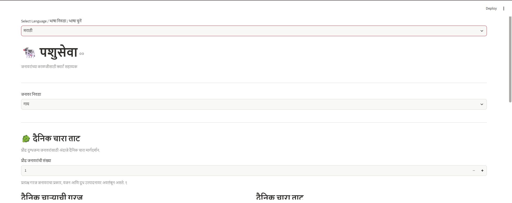
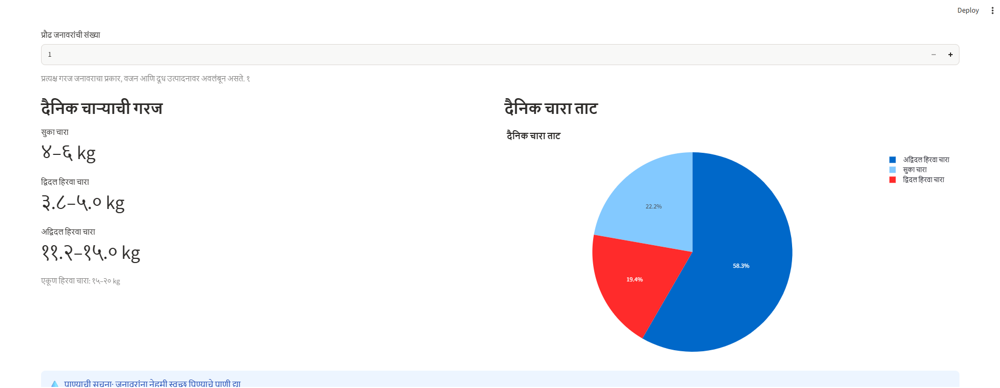
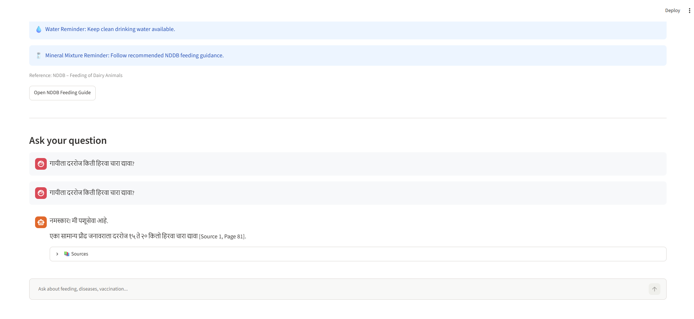

# PASHUSEVA – Smart Animal Care Information

[](https://github.com/shravani28-18/GEN-AI-TRAINING/actions/workflows/ci.yml)

PashuSeva is an AI-powered animal care information system designed to help small dairy farmers get reliable information about feeding, calf care, vaccination, common diseases, and dairy animal management.

The application uses trusted dairy-related documents and AI-based retrieval to provide relevant answers in English, Marathi, and Hindi.

## Project Objectives

- Provide reliable animal care information to dairy farmers.
- Help farmers understand feeding and nutrition requirements.
- Provide information about calf care, vaccination, and common diseases.
- Support farmers through multilingual AI-powered assistance.
- Reduce the difficulty of finding information from lengthy agricultural documents.

## Key Features

### 1. AI-Powered Question Answering
- Farmers can ask questions about dairy animal care.
- Uses Retrieval-Augmented Generation (RAG) to retrieve relevant information from reference documents.
- Generates responses using Gemini.
- Displays source references and page citations.
- Uses a safe fallback when the available documents do not support an answer.

### 2. Multilingual Support
- Supports English, Marathi, and Hindi.
- Accepts farmer questions in different supported languages.
- Provides answers in the user's selected or detected language.

### 3. Smart Search
- Searches relevant animal care records.
- Uses TF-IDF and cosine similarity for text-based search.
- Supports semantic search using vector embeddings and ChromaDB.

### 4. Daily Feed Plate
- Calculates approximate daily fodder quantities based on the number of adult dairy animals.
- Displays dry fodder and green fodder quantities.
- Shows a green fodder split of 1:3 between legume and non-legume fodder.
- Provides mineral mixture and clean water reminders.
- Displays feeding information through an interactive chart.

### 5. AI Agent and Tool Integration
- Uses an agent workflow to route farmer questions.
- Connects the RAG system with the vaccination scheduling tool.
- Includes an approval step for vaccination-related tool actions.

### 6. Feedback System
- Allows users to submit thumbs-up or thumbs-down feedback.
- Stores feedback in `data/feedback.json`.

### 7. FastAPI Backend
- Provides API endpoints for health checks, records, search, chat, AI questions, and agent operations.
- Connects the backend with the Streamlit interface.

## Technologies Used

- **Programming Language:** Python
- **Frontend:** Streamlit
- **Backend:** FastAPI
- **LLM:** Google Gemini
- **RAG:** Retrieval-Augmented Generation
- **Vector Database:** ChromaDB
- **Embeddings:** Text Embeddings
- **Search:** TF-IDF, Cosine Similarity, Semantic Search
- **AI Workflow:** LangGraph
- **Data Processing:** Pandas
- **API Communication:** Requests
- **Data Storage:** JSON

## Project Structure

```text
PASHUSEVA/
│
├── analysis/
│   └── explore.py
│
├── app/
│   ├── agent_loop.py
│   ├── chunking.py
│   ├── cli.py
│   ├── embed.py
│   ├── evaluate_semantic_search.py
│   ├── fetch.py
│   ├── graph.py
│   ├── ingest.py
│   ├── llm.py
│   ├── main.py
│   ├── models.py
│   ├── rag.py
│   ├── records.py
│   ├── smart_search.py
│   ├── tools.py
│   └── vectorstore.py
│
├── data/
│   ├── chroma_db/
│   ├── downloads/
│   │   └── pashuseva/
│   ├── raw/
│   ├── feedback.json
│   ├── pashuseva_questions.json
│   ├── records.json
│   ├── sample_records.py
│   ├── schemes_records.json
│   └── scheme_questions.json
│
├── docs/
│   └── how_llms_work.md
│
├── eval/
│   ├── eval_set.json
│   ├── prompt_compare.md
│   ├── results.json
│   ├── run_eval.py
│   ├── run_prompt_compare.py
│   └── search_results.md
│
├── prompts/
│   ├── system.txt
│   ├── task1.txt
│   ├── task1_v1.txt
│   ├── task1_v2.txt
│   └── task2.txt
│
├── screenshots/
│   ├── pashuseva_home.png
│   ├── pashuseva_feed.png
│   └── pashuseva_chat.png
│
├── ui/
│   └── app.py
│
├── day01_intro.py
├── day01_menu.py
├── .env.example
├── .gitignore
├── README.md
└── requirements.txt
```

## Installation and Setup

### 1. Clone the Repository

```bash
git clone https://github.com/shravani28-18/GEN-AI-TRAINING.git
cd GEN-AI-TRAINING
```

### 2. Create a Virtual Environment

```bash
python -m venv venv
```

Activate it on Windows:

```powershell
venv\Scripts\activate
```

### 3. Install Dependencies

```bash
pip install -r requirements.txt
```

### 4. Configure Environment Variables

Create a `.env` file in the project root and add your Gemini API configuration:

```env
GEMINI_API_KEY=your_gemini_api_key
GEMINI_MODEL=gemini-2.5-flash
```

Use your own API key. Do not upload the `.env` file to GitHub.

### 5. Run the FastAPI Backend

Open the first terminal:

```bash
uvicorn app.main:app --reload
```

API documentation:

```text
http://127.0.0.1:8000/docs
```

### 6. Run the Streamlit Application

Open a second terminal, activate the virtual environment, and run:

```bash
streamlit run ui/app.py
```

The Streamlit application will open in your browser.

## API Endpoints

| Method | Endpoint | Description |
|---|---|---|
| GET | `/health` | Checks API status |
| GET | `/records` | Retrieves animal care records |
| GET | `/records/{record_id}` | Retrieves a specific record |
| GET | `/search` | Searches animal care records |
| GET | `/search/semantic` | Performs semantic search |
| POST | `/questions` | Processes question-based record search |
| POST | `/chat` | Generates AI chat responses |
| POST | `/ask` | Provides RAG-based answers |
| POST | `/agent` | Runs the AI agent workflow |

## Screenshots

### Home Page



### Daily Feed Plate



### AI Chat Interface



## Data Sources

The project uses dairy animal care reference materials, including:

- National Dairy Development Board (NDDB) resources.
- Handbook of Good Dairy Husbandry Practices.
- Other downloaded dairy and animal care reference documents.

Answers are grounded in the available reference documents, with source and page citations where supported.

## Future Improvements

- Expand the animal care knowledge base.
- Improve multilingual voice-based interaction.
- Add more farmer-focused features.
- Improve retrieval accuracy and response evaluation.
- Enhance the vaccination reminder and scheduling workflow.

## Author

**Shravani Mahale**  
B.Tech – Artificial Intelligence and Data Science  
Sanjivani University

GitHub: [shravani28-18](https://github.com/shravani28-18)

---

**PashuSeva – Making reliable animal care information more accessible to dairy farmers.**


## Deployment

- API: https://pashuseva-ai.onrender.com
- UI: Local testing successful. Render UI URL pending.

### API Health Check
https://pashuseva-ai.onrender.com/health